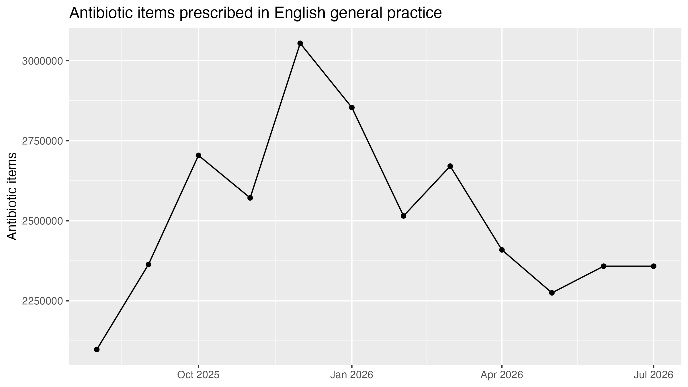
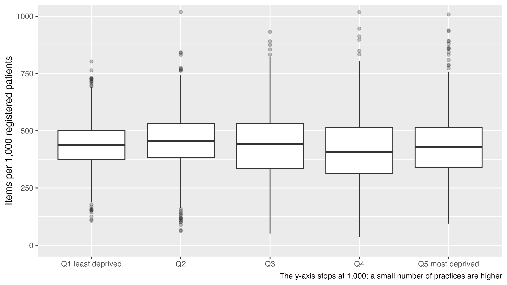
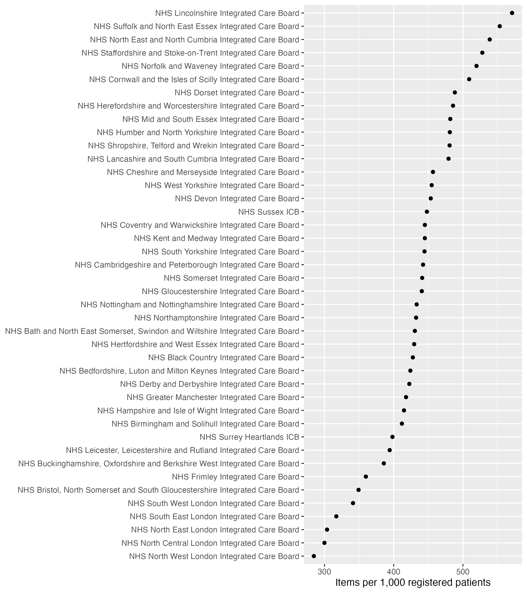
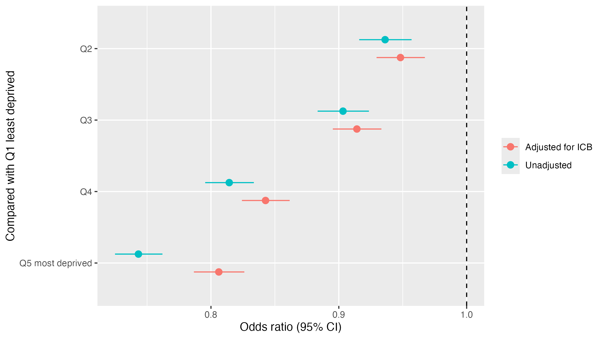

# Antibiotic Prescribing in English General Practice
### August 2025 – July 2026

## Executive Summary

This project examines variation in antibiotic prescribing across English general practices between August 2025 and July 2026, focusing on prescribing rates, broad-spectrum antibiotic use, socioeconomic deprivation and geographical differences.

The analysis combines prescribing data, GP registration records and area-level deprivation measures to investigate patterns across **6,121 general practices in England**.

Data processing was undertaken using SQL, DuckDB and PostgreSQL, followed by statistical analysis and visualisation in R.

## Headline Results

- **Total antibiotic prescribing:** After adjustment for Integrated Care Board (ICB), practices in the most deprived quintile had a lower estimated prescribing rate than those in the least deprived quintile (RR 0.939, 95% CI 0.916–0.963).
- **Broad-spectrum prescribing:** The most deprived quintile had lower adjusted odds of broad-spectrum prescribing (OR 0.806, 95% CI 0.787–0.826).
- **Sensitivity analysis:** Excluding Y-coded practices produced broadly consistent findings (adjusted RR 0.952; adjusted OR 0.809).
- **Geographical variation:** Prescribing patterns varied across GP practices and ICBs.

These findings represent practice-level associations and should not be interpreted as causal effects.

## Research Questions

1. How much do GP practices differ in antibiotic prescribing per 1,000 registered patients?
2. What proportion of antibiotic items are broad-spectrum antibiotics, including co-amoxiclav, cephalosporins and quinolones?
3. How are total antibiotic prescribing and broad-spectrum prescribing associated with practice-level deprivation?
4. How does prescribing vary across ICBs and over time?

## Data Sources

### 1. NHS Business Services Authority (NHSBSA)

**Dataset:** [English Prescribing Dataset (EPD) with SNOMED Code](https://opendata.nhsbsa.net/dataset/english-prescribing-dataset-epd-with-snomed-code)

Monthly prescribing data covering August 2025 to July 2026 were obtained from the NHSBSA Open Data Portal.

The dataset contains practice-level prescribing information, including BNF codes and prescription item counts. Monthly CSV files were processed individually because of their large file sizes.

**Licence:** Open Government Licence v3.0.

**Required attribution:** "NHSBSA Copyright 2021-2026".

### 2. NHS England

**Dataset:** [Patients Registered at a GP Practice, October 2025](https://digital.nhs.uk/data-and-information/publications/statistical/patients-registered-at-a-gp-practice/october-2025)

The October 2025 publication provided:

- GP practice registered list sizes.
- Patient distribution across 2021 Lower-layer Super Output Areas (LSOAs).
- Practice-to-Integrated Care Board (ICB) mapping.

The October 2025 registration snapshot was used to provide practice population denominators and geographical reference information.

### 3. Ministry of Housing, Communities and Local Government (MHCLG)

**Dataset:** [English Indices of Deprivation 2025](https://www.gov.uk/government/statistics/english-indices-of-deprivation-2025)

Published on 30 October 2025, the English Indices of Deprivation 2025 provide deprivation measures for **33,755 LSOAs in England**, based on 2021 Census geography.

The analysis used the 2025 Index of Multiple Deprivation (IMD) scores rather than the 2019 release.

Higher IMD scores indicate greater deprivation.

The 2021 LSOA geography was used to ensure compatibility with the geographical codes in the NHS England registration data.

## Study Population

The primary analysis included **6,121 English GP practices**.

Practice eligibility criteria:

- At least 1,000 registered patients.
- At least 10 months of prescribing data.
- Available practice-level IMD score.

Practice-level deprivation was calculated using the patient-weighted mean of LSOA deprivation scores.

## Methodology

### Data Processing

- Data extraction and preparation using SQL.
- DuckDB used for initial data loading and processing.
- Monthly prescribing CSV files were processed individually.
- PostgreSQL used for relational data management and analytical dataset preparation.
- R used for statistical analysis and visualisation.

### Antibiotic Classification

The analysis focused on BNF section 0501 antibacterials, excluding 050109 and 050110.

Broad-spectrum antibiotics included:

- **Co-amoxiclav:** 0501013K0.
- **Cephalosporins:** 0501021*.
- **Quinolones:** 0501120*.

### Statistical Analysis

- Antibiotic prescribing rates were calculated as items per 1,000 registered patients.
- Both unweighted mean practice rates and patient-weighted prescribing rates were calculated across deprivation quintiles.
- Broad-spectrum prescribing was calculated as the proportion of antibiotic items classified as broad-spectrum.
- Negative binomial regression was used to model total antibiotic item counts, with the logarithm of registered list size included as an offset.
- Quasibinomial regression with a logit link was used to examine broad-spectrum prescribing share.
- Models were reported unadjusted and adjusted for ICB using categorical fixed effects.
- Rate ratios and odds ratios were reported with 95% confidence intervals.

### Sensitivity Analysis

A sensitivity analysis excluded GP practices with practice codes beginning with Y.

- Primary analysis: 6,121 practices.
- Sensitivity analysis: 5,876 practices.

The results were broadly consistent between the two analyses.

## Detailed Findings

### 1. Monthly Prescribing Patterns

Monthly antibiotic prescribing peaked in December 2025 at approximately **3.05 million items**, the highest level observed during the study period.

Prescribing subsequently declined overall, reaching approximately 2.28 million items in May 2026, before increasing slightly in June and July. A temporary increase was observed in March 2026.

### 2. Practice-Level Variation

Substantial variation was observed between GP practices and across ICBs.

Total prescribing rates did not demonstrate a clear unadjusted deprivation gradient.

### 3. Total Antibiotic Prescribing

After adjustment for ICB, the most deprived quintile had a lower estimated prescribing rate than the least deprived quintile:

- Adjusted rate ratio: 0.939.
- 95% confidence interval: 0.916–0.963.

### 4. Broad-Spectrum Prescribing

Broad-spectrum prescribing odds decreased progressively across increasing deprivation quintiles.

The ICB-adjusted odds ratio for the most deprived quintile was 0.806 (95% CI 0.787–0.826), compared with the least deprived quintile.

This represents approximately 19.4% lower odds, not a 19.4 percentage-point reduction.

### 5. Sensitivity Analysis

Excluding Y-coded practices did not materially change the main findings.

- Adjusted Q5 rate ratio: 0.952.
- Adjusted Q5 broad-spectrum odds ratio: 0.809.

## Selected Visualisations

### Monthly Antibiotic Prescribing

Monthly national antibiotic prescribing volume between August 2025 and July 2026.



### Prescribing Rates by Deprivation

Comparison of practice-level antibiotic prescribing rates across IMD quintiles.



### Geographical Variation Across ICBs

Variation in antibiotic prescribing across Integrated Care Boards.



### Adjusted Broad-Spectrum Prescribing Associations

ICB-adjusted odds ratios for broad-spectrum prescribing across deprivation quintiles.



## Model Diagnostics

The Poisson model showed substantial overdispersion (dispersion = 421.81), supporting the use of negative binomial regression.

The negative binomial model dispersion was 1.02, with an estimated theta of 9.71.

The quasibinomial model showed substantial extra-binomial variation (dispersion = 29.05; 22.00 after ICB adjustment), accounted for through the quasibinomial variance specification.

## Validation

National monthly prescribing volume and broad-spectrum share were compared with OpenPrescribing.

Data-matching checks:

- Prescribing items not matched to a registered practice: **10.03% of total prescribing items**.
- Registered patients matched to an IMD score: **99.80% of total registered patients**.

## Limitations

- The analysis is ecological and uses practice-level rather than individual patient-level data.
- Models were not adjusted for practice population age structure.
- Registered list size may not perfectly represent the population actually served.
- ICB fixed effects account for average differences between ICBs but do not automatically account for all residual within-ICB correlation.
- Prescribing items do not represent individual patients, clinical indications or treatment episodes.
- Dental prescribing and Pharmacy First prescribing are not included in the source data.
- The monthly analysis covers one year and cannot establish a recurring seasonal pattern.
- Findings represent associations rather than causal effects.
- Approximately 10.03% of prescribing items could not be matched to a registered practice and were unavailable for practice-level analyses.

## Repository Structure

```text
antibiotic-prescribing-england/
│
├── sql/
│   ├── d01_schema.sql
│   ├── d02_load_one_month.sql
│   ├── d03_prepare_reference.sql
│   ├── d04_export.sql
│   ├── p02_load.sql
│   ├── p03_practice_ref.sql
│   ├── p04_practice_year.sql
│   ├── p05_checks.sql
│   └── p06_views.sql
│
├── r/
│   └── 01_analysis.R
│
├── outputs/
│   ├── fig1_monthly_items.png
│   ├── fig1b_monthly_broad_share.png
│   ├── fig2_rate_by_quintile.png
│   ├── fig3_practice_variation.png
│   ├── fig4_icb.png
│   ├── fig5_rate_ratios.png
│   ├── fig6_odds_ratios.png
│   ├── summary_by_quintile.csv
│   ├── model_results.csv
│   └── model_checks.csv
│
├── outputs_sensitivity_no_Y/
│   ├── fig1_monthly_items.png
│   ├── fig1b_monthly_broad_share.png
│   ├── fig2_rate_by_quintile.png
│   ├── fig3_practice_variation.png
│   ├── fig4_icb.png
│   ├── fig5_rate_ratios.png
│   ├── fig6_odds_ratios.png
│   ├── summary_by_quintile.csv
│   ├── model_results.csv
│   └── model_checks.csv
│
├── .gitignore
└── README.md
```

## Reproducibility

The project uses the following processing stages:

1. Run SQL scripts `d01` to `d04` in DuckDB.
2. Load the exported data into PostgreSQL using `p02_load.sql`.
3. Prepare practice reference data using `p03_practice_ref.sql`.
4. Generate the practice-level analytical dataset using `p04_practice_year.sql`.
5. Run data quality checks using `p05_checks.sql`.
6. Create analytical views using `p06_views.sql`.
7. Run `r/01_analysis.R` in R.

Reproduction requires access to the original source datasets and appropriate database configuration. Raw source data and credentials are not included in this repository.

## Tools and Technologies

**Data Management:** SQL | PostgreSQL | DuckDB

**Statistical Analysis:** R | dplyr | MASS | Negative Binomial Regression | Quasibinomial Regression

**Research Methods:** Epidemiology | Deprivation Analysis | Practice-Level Analysis | Sensitivity Analysis

**Visualisation:** ggplot2 | Statistical Data Visualisation

**Version Control:** Git | GitHub
